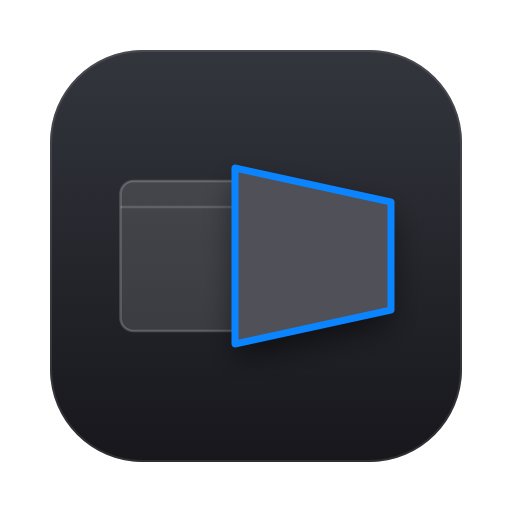
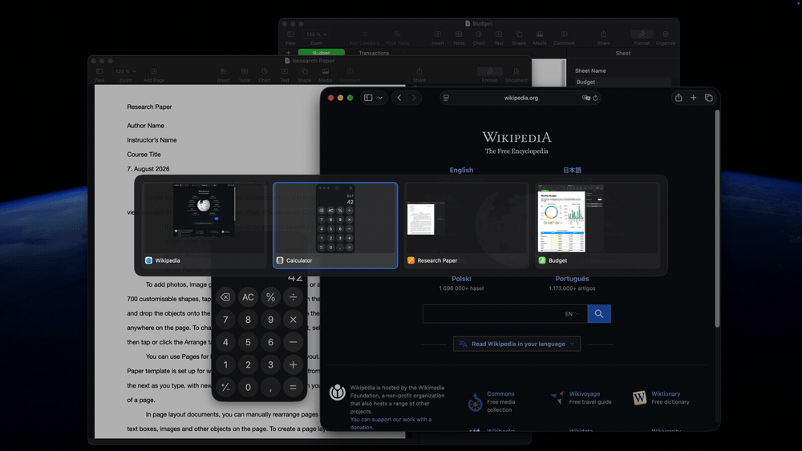
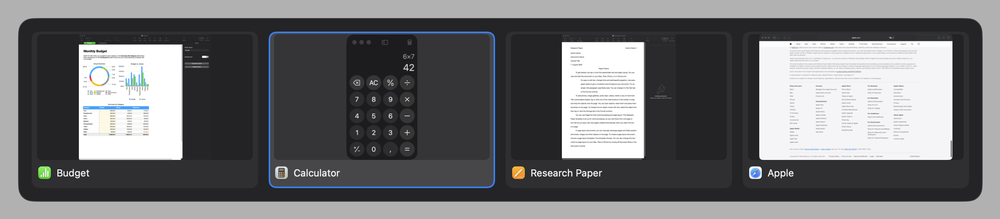

<p align="center">
  
</p>

<h1 align="center">Flip</h1>

<p align="center">
  A window switcher for macOS that gets out of the way.<br>
  Hold Command, tap Tab. Let go quickly and it switches without drawing anything.
</p>

<p align="center">
  <a href="https://mxwnk.github.io/flip/"><strong>mxwnk.github.io/flip</strong></a>
</p>

<p align="center">
  <a href="https://github.com/mxwnk/flip/releases/latest"></a>
  
  <a href="LICENSE"></a>
</p>

<p align="center">
  
</p>

## Install

```sh
brew install --cask mxwnk/tap/flip
```

Or download the disk image from the [latest release](https://github.com/mxwnk/flip/releases/latest). Needs macOS 14 or newer.

## Features

- 🪟 **Windows, not apps** – `⌘ Tab` lists every window, most recently used first
- ⚡️ **Fast** – let go within 150 ms and it switches without drawing anything
- 🎯 **One key per app** – `⌥ F` jumps to the Finder, add your own
- 📐 **Arrange windows** – halves, quarters, maximize and other displays from the keyboard
- 🗂️ **Layouts** – put a whole set of apps in place with one key
- 🌐 **Input source per app** – the keyboard layout follows the app in front
- 🖱️ **Keyboard or mouse** – hover, scroll and click work too
- 💻 **Command line** – `flip list`, `flip focus`, `flip arrange` and more

## Keys

| Switching | |
| --- | --- |
| `⌘ Tab` | all windows (add `⇧` to go backwards) |
| `⌥ Tab` | windows of the app in front |
| `⌥ F` | jump to an app, one key per app |
| arrows, `esc` | move the selection, or cancel |
| `⌫` while open | close the selected window |
| release the modifier | switch to the selected window |

| Arranging | |
| --- | --- |
| `⌃⌥ ←` `→` `↑` `↓` | halves |
| `⌃⌥ U` `I` `J` `K` | quarters |
| `⌃⌥ ↩` | maximize, press again to restore |
| `⇧⌥ ←` `→` | previous or next display |

Every key and modifier can be changed in **Settings** (`⌘,` from the menu bar icon).

<p align="center">
  
</p>

## Command line

Homebrew puts `flip` on your PATH; with the disk image, run `make link`.

```sh
flip list               # every window as JSON
flip focus 27461        # bring a window forward
flip arrange left-half  # move the focused window
flip layout coding      # apply a layout
flip switch             # open the switcher
flip pause              # hand ⌘Tab back to macOS, then `flip resume`
```

## FAQ

**Why does it want Screen Recording?** Only for thumbnails. Turn them off in Settings and Flip shows app icons instead.

**macOS says the disk image can't be checked for malicious software.** Flip is signed but not notarised. Open **System Settings › Privacy & Security**, scroll to *Security* and click **Open Anyway**, or run:

```sh
xattr -d com.apple.quarantine ~/Downloads/Flip-*.dmg
```

Homebrew does this for you.

**Do I have to grant permissions again after an update?** No, every release is signed with the same certificate.

**`⌘ Tab` suddenly shows the normal macOS switcher.** An app, usually a password manager, has left *Secure Input* on, and macOS hides your keystrokes from Flip. Flip shows a lock in the menu bar and explains it; quitting that app fixes it.

**Where are my settings?** In `~/Library/Application Support/Flip/config.json`. Edits by hand apply right away.

**Something is wrong.** Open **Diagnostics…** from the menu bar, copy the report and [open an issue](https://github.com/mxwnk/flip/issues).

## Contributing

Building, testing and releasing: [docs/development.md](docs/development.md). What changed: [CHANGELOG.md](CHANGELOG.md).

## License

MIT, see [LICENSE](LICENSE).
